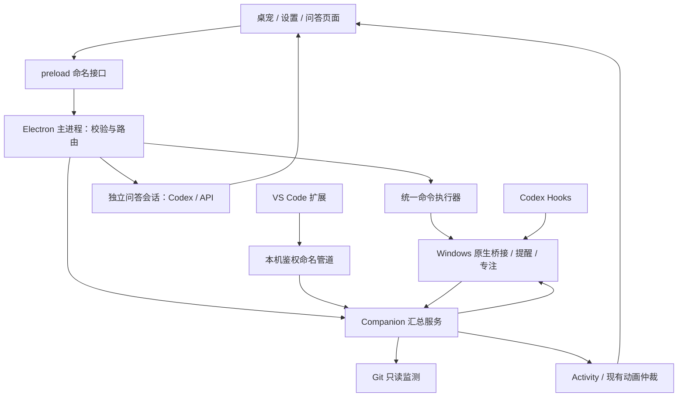

# GrokPet 开发文档

核对日期：2026-10-30。包元数据版本：`0.8.0`。本文描述当前工作区实现，不代表新增发布标签；历史阶段记录中的版本、测试数量和“下一阶段”需按记录日期理解。

配套文档：[使用说明](USER_GUIDE.md)、[文档索引](index.md)、[开发约定](../AGENTS.md)。

## 1. 项目定位与边界

GrokPet 是 Windows 本地桌面工作伙伴：以透明悬浮宠物为入口，整合文字问答、本地操作、提醒待办、专注计时、系统状态、媒体及下载状态、Git 和 VS Code 摘要。

桌宠使用原有 SVG 角色引擎。界面是 Electron 页面加局部 React 控件，不是完整 React SPA。角色动画、系统状态和工作事件共用已有调度链路，不应为新功能另建角色动画调度器。

当前只读项目监测、聊天和本地命令有明确边界：

- Git 监测不提交、推送、重置或读取文件正文。
- API 聊天不自动附带项目、系统指标或文件。
- Codex 项目问答使用用户明确选择的参考目录；快捷问答与完整窗口上下文分离。
- 应用启动只能使用已登记白名单目标；模型不能返回 shell 文本让程序执行。
- 对话结束、Git 干净、诊断清零、调试停止均不等于任务验收成功。

## 2. 当前能力与交付边界

| 模块 | 已实现 | 限制或待验收 |
| --- | --- | --- |
| 桌宠 | 透明、拖动、托盘、隐藏、暂停、漫游、大小/颜色/身形、基础养成和作息 | 喂食、追球、多宠物未实现 |
| 快捷界面 | 独立卡片列表/轮播、对话卡片、滚轮及渐隐、环绕控制和系统详情 | 实体多屏、混合 DPI 需单独验收 |
| 问答 | Codex 与兼容 API、独立入口、流式结果、停止、历史、复制/重显/完整回答 | 无免费无限 ChatGPT 直连；参考目录不自动用于 API |
| 语音 | Windows 本地 STT/TTS、可选兼容 API、按键录音、校对后发送、停止播报 | 真实麦克风、口音/噪声和扬声器听感尚待使用者验收 |
| 本地操作 | 白名单应用/文件夹、主音量、媒体、系统查询、提醒、待办和专注 | 删除文件、任意脚本、关闭程序、电源关机不在首版 |
| 系统与设备 | CPU/内存/GPU、网速、VPN/代理、60 秒趋势、持续负载阈值；Wi-Fi/蓝牙/亮度/电源面板 | 硬件能力和系统权限决定可用项；蓝牙通用连接/配对交给 Windows |
| 下载/安装 | 浏览器扩展、迅雷/百度网盘窗口检测、常见安装器公开进度检测 | 私有或提权控件可能只能报告状态未知；不猜测完成 |
| 剪切板 | 主动开启后运行内文字/图片历史、直接预览、点击粘贴、滑动删除 | 30 项及体积限制；不等同 Windows 全部剪切板格式 |
| 工作联动 | Codex 工作事件中心、Git 登记与只读状态、VS Code 诊断/调试/心跳 | 真实构建/测试结果适配、长期记忆、截图问答未实现 |
| 通知 | 队列、聊天保护期暂缓、投递确认、提醒操作；Windows 通知授权入口 | 第三方通知真实端到端仍待验收；队列有上限和过期策略 |

## 3. 技术栈与环境

| 项目 | 当前配置 |
| --- | --- |
| 桌面容器 | Electron 41.10.6；主进程 CommonJS |
| 渲染 | 原生 HTML/CSS/JS；React 19 局部挂载 |
| 控件 | 本地 UIArc 源码、Motion、Radix；保留 Cult 历史组件及适配 |
| UI 构建 | esbuild、Tailwind CSS |
| 原生桥接 | .NET 10、Windows Desktop/WPF、Windows API |
| 编辑器扩展 | VS Code 扩展，清单要求 VS Code `^1.85.0` |
| 测试 | Node test runner、Electron 冒烟、原生窗口夹具 |

开发机需要能够运行当前 Electron 工具链的 Node.js/npm；项目未声明统一 Node `engines` 版本，环境升级后应重新执行安装和验证。原生开发需要 .NET 10 SDK 与对应 Windows 构建依赖。运行版系统联动依赖 .NET 10 Windows Desktop Runtime。Git、Codex CLI 和 VS Code 仅对应功能需要。

## 4. 目录与职责

| 路径 | 职责 |
| --- | --- |
| `desktop/main.cjs` | 应用生命周期、窗口、托盘、IPC、安全校验、服务装配及动画仲裁 |
| `desktop/preload.cjs` | contextBridge 命名接口；页面不直接使用 Node |
| `desktop/core.js` | 设置归一、窗口边界、命中检测、PetBrain、动画选择 |
| `desktop/companion.cjs` / `companion-core.cjs` | 指标/媒体/工作汇总，Activity、通知及持续负载处理 |
| `desktop/assistant*.cjs`、`api-chat.cjs`、`codex-client.cjs` | 问答入口、会话/回合归属及后端连接 |
| `desktop/command-executor.cjs` | 按钮与文字命令共用的执行器 |
| `desktop/local-commands.cjs` / `system-commands.cjs` | 明确命令解析、提醒持久化、白名单应用与系统操作 |
| `desktop/focus.cjs`、`scenes.cjs`、`pet-life.cjs` | 专注恢复、场景、指标趋势和基础养成 |
| `desktop/voice*.cjs` | 语音配置、录音/合成服务、超时与取消 |
| `desktop/clipboard-history.cjs` / `clipboard-paste.cjs` | 有界内存历史、原窗口粘贴与失败回退 |
| `desktop/work/` | 工作事件、Codex 适配、Git 项目监测、VS Code 鉴权桥接 |
| `pet/index.html` / `pet.js` | 桌宠页面、输入、气泡、状态与媒体呈现 |
| `pet/dock-ui.js` / `hud-card.js` / `radial.js` | 列表/轮播、剪切板、系统卡片、同窗口环绕展开 |
| `pet/panel.*` / `assistant.*` | 设置与完整问答窗口 |
| `ui/arc-controls.tsx` / `ui/arc-controls.css` | UIArc 控件适配、旧 DOM 保留、菜单及原生命中区域发布 |
| `ui/vendor/arc/` | 本地控件源码和样式；许可证见 third-party |
| `replica/src/` | SVG 角色、姿态、眼睛、特效及数学模块 |
| `native/BlobPetBridge/` | 指标、媒体、音量、设备、下载/安装探测、Hooks、粘贴等原生桥接 |
| `browser/extension/` | Edge/Chrome 下载扩展 |
| `vscode/extension/` | VS Code 摘要扩展源码 |
| `scripts/`、`tests/`、`docs/` | 启动/构建/发布、单元测试、说明和验收记录 |

`pet/arc-controls.js`、`pet/arc-controls.css` 为生成产物。优先修改 `ui/` 源码再构建，避免仅改生成文件后被覆盖。

## 5. 运行架构与数据流



### 5.1 文字与本地命令

明确命令在模型调用前由解析器识别，进入统一执行器。浏览器搜索模式保持搜索行为；本地指令模式不把未知表达发给模型；聊天模式未匹配命令才走当前后端。按钮提交结构化动作，也使用同一校验路径。

增加命令时需同步检查：解析歧义、输入边界、白名单身份、重复提交、取消范围、失败反馈。不要将模型自然语言回复再作为系统命令自动执行。

### 5.2 问答与通知

快捷入口和完整窗口各自持有会话、请求及取消范围。回复相关“完整回答/复制/重显/朗读”需绑定同一条回复，不能仅引用全局最后一条文本。快捷历史有运行内上限，不是长期记忆。

聊天状态通过气泡保护避免被闲聊提示覆盖。普通通知经队列和确认投递处理；紧急提醒与专注规则单独判断。过期或有界队列被清理的提示不能宣称永久保存；持久化提醒仍从提醒列表查阅。

### 5.3 工作事件与动画

现有路径：`Companion.receive → WorkController / Activity → main.tick → selectAnimation → SVG 引擎`。

工作事件按来源、项目、会话和轮次隔离，校验时间、序列、TTL、重复及终态。`task.verified` 的可信内部显式证据才代表验收结果；不向模型、普通 renderer 或原始 Hooks 开放任意“验收成功”入口。

| 来源状态 | 典型动作 | 说明 |
| --- | --- | --- |
| 分析/搜索/写入 | thinking / searching / writing | 依赖可识别事件；未知工具不猜分类 |
| 等待处理/明确失败 | 提醒动作 / confused / sad | 保留待处理和失败语义 |
| 可信验收成功 | proud / celebrate | 普通对话结束不触发任务成功 |
| 录音/连接/播报 | dictating / loading / humming 等 | 由既有语音阶段和超时控制 |
| 专注/下载进度 | orbit / progress / receiving | 有可靠百分比时驱动真实进度 |
| 音乐 | dictating 和音符 | 当前为循环律动，不是真实频谱分析 |
| 持续高负载 | 负载动作 | 仅空闲时让出后的低优先级提示 |

### 5.4 透明窗口与控件

可见 DOM 不等于 Windows 能收到点击。需要同时保证 CSS `pointer-events`、窗口可见/尺寸、原生交互矩形和悬停路径正确。

- 轮播导航必须位于允许鼠标事件的 deck 中；DOM `.click()` 无法证明真实命中路径。
- 独立侧栏必须跟随 HUD 显隐；隐藏区域不能继续发布为原生命中区域。
- 列表限高但保留滚轮，隐藏滚动条并根据实际溢出显示渐隐。
- 环绕卡片先收起快捷区，再调整窗口/展开；关闭恢复原位置，保留悬停宽限。
- 保留旧控件 DOM 身份及事件监听，避免 React 重挂载导致按钮失效。

## 6. 数据、配置与隐私

### 6.1 数据目录

| 环境 | 数据位置 |
| --- | --- |
| 正式运行版 | EXE 同目录 `data/` |
| 源码运行 | `.runtime/user-data/` |
| 冒烟测试 | 被测 app 根目录 `artifacts/smoke-data/` |

| 文件/数据 | 用途与保存方式 |
| --- | --- |
| `settings.json` | 外观、显示、功能开关、场景、养成等 |
| `focus.json` | 专注状态、剩余时间与截止时刻；运行中按实际截止时间恢复，暂停保持暂停 |
| `reminders.json` | 提醒、待办、重复及确认状态 |
| `lyrics.json` | 本地 LRC 及歌曲绑定 |
| `api-profiles.json` / `voice-settings.json` | 文本和语音分别配置；密钥由 safeStorage 加密 |
| `launch-targets.json` / `projects.json` | 应用/文件夹白名单与 Git 登记 |
| `vscode-trusted.json` | 配对凭据哈希 |
| `vscode-pair.json` | 临时一次性配对资料；5 分钟有效，成功配对或停止服务时清理 |
| `assistant-workspace/` / `session/` | 助手工作目录及 Electron 会话数据 |
| 内存状态 | 剪切板历史、指标趋势、工作事件及快捷回复缓存；不是永久记录 |

不要把正式 data、配对文件、密钥、日志中的敏感内容提交到仓库。加密密钥与本机用户环境绑定，复制数据目录不保证在其他用户/电脑可解密。

### 6.2 关键约束

| 配置/服务 | 当前范围 |
| --- | --- |
| 专注 | 1–180 分钟；默认 25；progress 或 orbit |
| 手动提醒场景 | 1–10080 分钟；自定义场景最多 12 个 |
| 高负载 | 默认 CPU 85%、内存/GPU 90%，持续 8 秒；极高负载另有 97%/8 秒规则 |
| 趋势 | 最近 60 秒，最多 120 个样本；缺失采样留空 |
| API 配置 | 最多 20 个；兼容 Chat Completions、SSE/JSON；非通用厂商协议适配器 |
| Git | 最多 12 项；15 秒串行检查，单仓库预算 4 秒 |
| VS Code | 5 秒心跳；20 秒无更新转离线/未知；最多 20 个会话摘要 |
| 剪切板 | 主动开启；最多 30 项/总计 16 MiB/单项 4 MiB，文字最多 20000 字符 |

约束的权威位置是各服务校验代码；更改范围时同时更新测试、界面提示和本文。

### 6.3 权限及外部服务

渲染窗口使用 `contextIsolation` 和 sandbox；主进程验证 IPC sender、参数、身份和边界。外部程序使用固定程序及参数数组，不用模型内容拼接 shell。

Codex 使用已登录 CLI/App Server；Hooks 安装必须由用户显式触发并备份原配置。自定义 API 发送聊天文本；语音 API 会发送音频或待播报文本。Git 和 VS Code 摘要不自动发送给模型。Windows 通知、剪切板、下载来源可分别关闭。

剪切板粘贴只接收既有历史 ID。目标窗口信息保留在主进程，原生层再次检查窗口身份、前台和输入条件；失败保留已复制内容供手动粘贴，不提升权限绕过系统限制。

## 7. 开发、构建与测试

以下命令在项目根目录的 PowerShell 执行：

```powershell
npm ci
powershell -NoProfile -ExecutionPolicy Bypass -File scripts/build-bridge.ps1
node scripts/build-ui.cjs
npm start
```

`npm ci` 按现有 lockfile 安装依赖，需要下载依赖时需网络。`npm start` 使用 `scripts/start.cjs` 和当前可用 Electron 运行时；`.runtime/electron` 是本机备用路径，不能假设新电脑已有。

```powershell
npm test
npm run smoke
powershell -NoProfile -ExecutionPolicy Bypass -File scripts/build-vscode.ps1
```

VS Code 输出：`vscode/GrokPet-work-bridge.vsix`。扩展源码在 `vscode/extension/`，不在 vscode 根目录。

完整冒烟不能替代各模块专项。主入口的专项选择见 `desktop/main.cjs`：例如 `--pet-dock-clipboard-smoke`、`--pet-vscode-smoke`、`--pet-git-projects-smoke`、`--pet-local-voice-smoke`。专项运行必须同时带 `--pet-smoke`，否则不会选择隔离测试路径。

暂存包专项示例（使用下节生成的目录）：

```powershell
Start-Process -FilePath '.\dist\BlobPet-validation\BlobPet.exe' `
  -ArgumentList '--pet-smoke','--pet-dock-clipboard-smoke' `
  -WindowStyle Hidden -Wait
```

测试按数据目录串行运行，避免同时使用同一 smoke-data 导致缓存锁和状态干扰。自动化鼠标事件、虚拟麦克风及合成语音应分别标明，不能据此宣称实体设备全部验收。

## 8. 打包、更新与回滚

Electron 打包产物是整个目录，不是独立单文件 EXE。不要直接打包覆盖正在运行的正式目录。

```powershell
$env:BLOBPET_PACKAGE_OUTPUT = Join-Path (Get-Location) 'dist\BlobPet-validation'
npm run package
node scripts/smoke.cjs --packaged
Remove-Item Env:BLOBPET_PACKAGE_OUTPUT
```

暂存目录应是 `dist` 的直接子目录；每次选择新的目录。打包前先构建原生桥接，修改 UI 后重新构建。以上删除的是本 PowerShell 会话环境变量，不是安装包或数据。

仓库提供 `npm run release`：构建暂存包、运行回归、备份旧目录并迁移 data。其完整目录切换要求正式进程已经退出；文件占用时会失败，需要核对输出，不应当作热更新。

更新顺序：

1. 核对实际正式路径、进程及 data，记录本次变更文件。
2. 构建新包并通过必要测试。
3. 退出正式进程，备份旧程序文件和必要的数据。
4. 更新程序并保留现有 data，核对文件哈希和数据未被覆盖。
5. 重启正式实例并确认窗口/关键入口；再清理本轮临时包。

回滚时退出新程序，恢复对应备份的程序文件。若新增数据格式不向后兼容，需使用同批数据备份，不能猜测可直接降级。临时验收包与正式程序的 data 不可混用。备份不是发布包，不应无边界积累旧的 Electron 全目录。

## 9. 验收基线与后续方向

最近交付记录：172 项 Node 测试、打包完整回归/重启及快捷卡片专项通过；详情见 [卡片与联动验收](dock-clipboard-work-verification-2026-10-30.md)。本文编写期间核对源码和记录，未重新运行设备验收。

尚需真实设备验证：麦克风创建提醒/取消/打断播报、扬声器听感、实体多屏/混合 DPI、第三方 Windows 通知、未公开进度安装器及不同下载器版本。

计划中的后续工作：真实构建/测试退出码和证据适配；显式可删的项目记忆；用户主动截图预览与视觉问答。均应单独设计权限和验收，不能把已有枚举或界面入口写成已经实现。

## 10. 开源前检查

README 当前声明项目含学习复刻及提取素材，不能把整个项目标为 MIT 或直接再分发。UIArc/Cult 等组件许可仅覆盖各自内容。

开源前核对第三方许可证、角色/商标/图标/提取素材来源，替换无再分发依据的内容；排除 data、配对文件、密钥、私人项目路径和运行产物；整理提交、版本、迁移和安装依赖。不要因为新增代码是自主编写，就推断原素材也获得开源授权。
